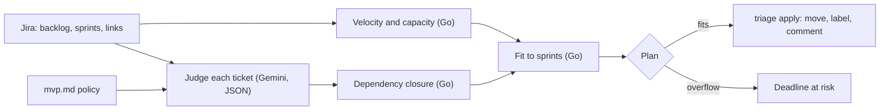

# Algorithmic Triage

**Decide what your MVP doesn't need, and check that the rest fits before the deadline.**

`triage` reads your Jira Scrum board, judges every backlog ticket against a
short written MVP policy ([`context/mvp.md`](context/mvp.md)) using Gemini,
and plans the MVP work into the sprints you have left. It shows you the plan
first. Nothing in Jira changes until you approve it.

```
Algorithmic Triage  TRIP · policy context/mvp.md

  Velocity   18 → 22 → 20  =  20 pts/sprint (last 3 closed sprints)
  Judge      judging 29 tickets with Gemini .............................
  Capacity   TRIP Sprint 5                7 pts  (20 − 13 carried over from TRIP Sprint 4)
             TRIP Sprint 6 (Demo day)    20 pts
  Backlog    29 tickets · 174 pts estimated

  KEY       PTS  PRIORITY  VERDICT  PLACED       WHY
  TRIP-35    13  Highest   V2       V2 backlog   Personalised dashboards, recommendation engines, AI sentiment…
  TRIP-37     5  High      MVP      Sprint 6     This ticket directly satisfies Golden Path step 4 by displaying…
  TRIP-43     1  Low       MVP      Sprint 5     Recording privacy consent during sign-up is an explicit non-ne…
  ...

  Result
  MVP        6 items · 15 pts  (Sprint 5 7/7 · Sprint 6 8/20)
  V2         23 tickets
  Deadline   ✔ MVP fits before demo day, 12 pts spare
```

Built for the GDG DevFest Brisbane 2026 talk *Algorithmic Triage: Teaching AI
to say no to your backlog*.

---

## Contents

- [Who this is for](#who-this-is-for)
- [How it decides](#how-it-decides)
- [What you need](#what-you-need)
- [Setup, step by step](#setup-step-by-step)
- [Run it](#run-it)
- [Write your own mvp.md](#write-your-own-mvpmd)
- [Try it on a demo board](#try-it-on-a-demo-board)
- [Troubleshooting](#troubleshooting)
- [Cost, limits and data privacy](#cost-limits-and-data-privacy)
- [For developers](#for-developers)

---

## Who this is for

| You are | You'll mostly touch |
|---|---|
| **BA, product owner, founder** | `context/mvp.md`: the policy the AI judges against. Then read the plan and approve it. |
| **Scrum master, delivery lead** | The plan output: velocity, capacity, what fits, and anything flagged *deadline at risk*. |
| **Developer** | Setup, the Go code in `internal/`, and wiring it into CI or a Jira webhook. |

You don't need to write code to use it. You do need to run two commands in a
terminal; every step is below.

## How it decides

**The LLM makes judgements. Plain code does the arithmetic.**



1. **Velocity** is the average of the points completed in your last three
   closed sprints. Unfinished work in the current sprint is assumed to carry
   over, so it is taken off the next sprint's capacity.
2. **Judge.** Each backlog ticket is sent to Gemini together with your
   `mvp.md`. Gemini must answer in a fixed JSON shape: a verdict (`MVP`, `V2`
   or `SPLIT`), the line of `mvp.md` it applied, which golden-path step the
   ticket serves, an estimate, a confidence, and a one-sentence reason.
3. **Dependencies.** Anything that blocks an MVP ticket (a Jira "blocks" link)
   becomes MVP too.
4. **Fit.** MVP work is placed into your remaining sprints, blockers first,
   then by golden-path step and priority. If it doesn't all fit, the plan says
   **deadline at risk** and names the tickets. It never silently drops one.

## What you need

| | What | Where to get it | Time |
|---|---|---|---|
| 1 | **Go 1.23 or newer** | [go.dev/dl](https://go.dev/dl/) (Mac: `brew install go`) | 5 min |
| 2 | **A Jira Cloud site** with a **Scrum** project | Your company's site, or a free one at [atlassian.com/software/jira/free](https://www.atlassian.com/software/jira/free) | — |
| 3 | **An Atlassian API token** | [id.atlassian.com → Security → API tokens](https://id.atlassian.com/manage-profile/security/api-tokens) | 1 min |
| 4 | **A Gemini API key** | [aistudio.google.com/apikey](https://aistudio.google.com/apikey) | 1 min |

Your Jira project needs:

- **Story points** on tickets (the board's estimation field).
- **At least one closed sprint**, so velocity can be measured. Three is better.
- **Future sprints** created up to your deadline. The plan fills these.

## Setup, step by step

### 1. Get the code

```bash
git clone https://github.com/geekaara/algorithmic-triage.git
cd algorithmic-triage
```

### 2. Create your Atlassian API token

1. Open [id.atlassian.com/manage-profile/security/api-tokens](https://id.atlassian.com/manage-profile/security/api-tokens).
2. Click **Create API token**. Use the plain button, **not** "Create API token
   with scopes"; scoped tokens need a different address and won't work with
   these steps.
3. Name it `algorithmic-triage`, pick an expiry, and copy the token. You
   won't see it again.

The token acts as you, so it can only see and change what your Jira account
can.

### 3. Create your Gemini API key

1. Open [aistudio.google.com/apikey](https://aistudio.google.com/apikey) and
   sign in with a Google account.
2. Click **Create API key** and copy it.

The free tier is enough to try it. See
[Cost, limits and data privacy](#cost-limits-and-data-privacy) before using
company data.

### 4. Put your settings in `.env`

```bash
cp .env.example .env
```

(Windows: `copy .env.example .env`.) Open `.env` in any text editor and fill
it in:

| Setting | What to put | Example |
|---|---|---|
| `JIRA_BASE_URL` | Your Jira site address, no trailing slash | `https://acme.atlassian.net` |
| `JIRA_EMAIL` | The email you log in to Jira with | `alex@acme.com` |
| `JIRA_API_TOKEN` | The token from step 2 | `ATATT3x…` |
| `JIRA_PROJECT` | The project key, the prefix of your ticket numbers | `TRIP` for `TRIP-35` |
| `GEMINI_API_KEY` | The key from step 3 | `AIza…` |
| `GEMINI_MODEL` | Optional. Leave blank | |

`.env` is ignored by git. Never paste these keys into chat, tickets or slides.

### 5. Check it works

```bash
go run ./cmd/triage plan
```

The first run downloads nothing extra (there are no third-party Go
dependencies) and should print your velocity within a few seconds. If you get
an error, see [Troubleshooting](#troubleshooting).

## Run it

### `plan`: see what it would do (safe, changes nothing)

```bash
go run ./cmd/triage plan
```

It prints the table above and saves the full plan to `plan.json`. Run it as
often as you like. Gemini's answers are cached in `.triage-cache/`, so re-runs
take about two seconds and give identical results until a ticket or
`mvp.md` changes. To force fresh answers: `go run ./cmd/triage plan -refresh`.

Read the plan before going further. In particular:

- **V2** tickets: is anything important being cut? If so, the policy is
  missing something. Fix `mvp.md` and run `plan` again; don't argue with the
  ticket.
- **Deadline at risk**: the must-haves don't fit. That's a conversation for
  the team, not something to automate.
- **`~` estimates** (like `~2`): the ticket had no points, so Gemini
  estimated it. Check those.

### `apply`: write the plan to Jira

```bash
go run ./cmd/triage apply
```

This carries out exactly what's in `plan.json`:

| It does | Undo by hand |
|---|---|
| Moves MVP tickets into your future sprints | Drag them back to the backlog |
| Adds labels `mvp` or `v2`, plus `ai-triaged` | Remove the labels |
| Sets each planned sprint's goal | Edit the sprint goal |
| Creates a new ticket for each `SPLIT` (the MVP slice) | Delete the new ticket |
| Comments on every ticket with the verdict, rule and reason | Delete the comments |

Tickets labelled `ai-triaged` are skipped next time, so new tickets can be
triaged later without redoing old ones. Run `apply` once per plan.

### Options

| Command | What it does |
|---|---|
| `go run ./cmd/triage plan -policy path/to/policy.md` | Use a different policy file |
| `go run ./cmd/triage plan -out other.json` | Write the plan somewhere else |
| `go run ./cmd/triage apply -plan other.json` | Apply a specific plan file |

## Write your own mvp.md

This file is the most important part, and it doesn't need a developer. Copy
[`context/mvp.md`](context/mvp.md) and keep its sections:

1. **Product**: one or two sentences on what it is.
2. **Deadline**: the date, and what happens on it.
3. **Golden path**: the numbered steps your users (or investors) must be able
   to complete. A ticket is MVP only if a step breaks without it.
4. **Non-negotiables**: legal, security and stability work you'll do
   regardless of size. Name your actual obligations (for example, privacy law).
5. **Out of scope**: say what you are *not* building yet, explicitly. This is
   where most of the cutting comes from.
6. **Triage rules**: keep the five in the example, or adapt them.

Tips:

- Write it with the stakeholders, once. After that, disagreements are about
  the policy, not about individual tickets.
- Be specific. "AI / ML features of any kind" cuts reliably; "nice-to-haves"
  does not.
- If the plan cuts something you need, add it to the golden path or the
  non-negotiables and run `plan` again.

## Try it on a demo board

`cmd/seed` loads the **Tripline** demo used in the talk into an empty Scrum
project: 9 epics, 54 tickets, dependency links, three closed sprints (18, 22
and 20 points), an active sprint, and two empty future sprints.

1. In Jira, create a **company-managed Scrum** space with no sample items.
   Note its key and put it in `JIRA_PROJECT`.
2. Run:
   ```bash
   go run ./cmd/seed -dry-run   # shows what it will create
   go run ./cmd/seed
   ```
3. Run `go run ./cmd/triage plan`.

The seeder can be re-run safely: it matches tickets by title and won't
create duplicates. Use it on a throwaway project only; it closes sprints.

## Troubleshooting

| Message or symptom | Cause | Fix |
|---|---|---|
| `401 Client must be authenticated` | The token is wrong, was made "with scopes", or belongs to a different account than `JIRA_EMAIL` | Create a new token with the plain **Create API token** button, logged in as the same email, and paste it again |
| `missing JIRA_API_TOKEN …` | `.env` is missing or a value is empty | Check step 4. Run commands from the project folder |
| `no scrum board for project X` | Wrong `JIRA_PROJECT`, or the project is Kanban | Use the key of a Scrum project |
| `no future sprints to plan into` | No sprints created after the current one | Create future sprints in the backlog view |
| `Gemini … 429 … quota` | Free-tier rate limit (a few requests a minute, limited per day) | Wait, or enable billing on the key's Google Cloud project. Answers already received are cached |
| `Gemini … 503 high demand` | That model is busy | It retries and falls back to other models automatically. Or set `GEMINI_MODEL` |
| Story points show as `-` on Tasks or Bugs | The Story Points field isn't on those issue types' screens | Jira settings → Issues → Screens → add *Story Points* to the project's screens |
| `Nothing to triage` | Every backlog ticket already has the `ai-triaged` label | Expected after `apply`. Remove the label from tickets you want re-judged |

## Cost, limits and data privacy

- **Cost.** One run sends each untriaged ticket's text once, in batches. On a
  paid key a 30-ticket run costs a few cents. Cached re-runs cost nothing.
- **Free tier.** Fine for trying it out, but limited to a few requests a
  minute and a small daily quota.
- **What is sent to Google.** Ticket summaries, descriptions, priorities,
  estimates, dependency titles and your `mvp.md`. No code, no attachments, no
  comments, no user names.
- **Company data.** On the free tier, Google may use prompts to improve its
  products. For real company backlogs, use a key from a project with billing
  enabled (paid tier) or Vertex AI, and check with your security team.
- **Jira access** is limited to what your own Jira account can do.

## For developers

```bash
go test ./...     # deterministic planner tests: velocity, dependencies, capacity
go vet ./...
go build -o bin/triage ./cmd/triage
```

| Path | What |
|---|---|
| `context/mvp.md` | Example MVP policy |
| `cmd/triage` | The engine: `plan` and `apply` |
| `cmd/seed` | Seeds the Tripline demo board |
| `internal/triage/board.go` | Loads tickets, sprints, links and velocity from Jira |
| `internal/triage/judge.go` | Prompt, response schema, batching and the answer cache |
| `internal/triage/plan.go` | Deterministic planning: velocity, dependency closure, capacity fit |
| `internal/jira` | Minimal Jira Cloud REST and Agile client (standard library only) |
| `internal/gemini` | Gemini `generateContent` with a response schema, retries and model fallback |

Design notes:

- **No third-party dependencies.** Everything uses Go's standard library.
- **Plan, then apply.** `plan.json` is the reviewed artifact; `apply` never
  re-asks the model.
- **Reproducible.** Temperature 0 plus the prompt-hash cache means the same
  board and policy give the same plan.
- **Next:** feed the model a map of the codebase, so it can tell "the profile
  table already exists" from "needs new infrastructure" when estimating.
