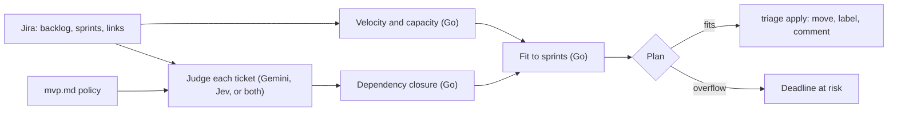

# Algorithmic Triage

**Decide what your MVP doesn't need, and check that the rest fits before the deadline.**

`triage` reads your Jira Scrum board, judges every backlog ticket against a
short written MVP policy ([`context/mvp.md`](context/mvp.md)), and plans the
MVP work into the sprints you have left. It shows you the plan first. Nothing
in Jira changes until you approve it, and `reset` undoes it.

Tickets can be judged by an LLM (**Gemini**), a decision model (**Jev**, via
Vercel AI Gateway), or **both combined**, where each does the job it is best
at.

```
Algorithmic Triage  TRIP · policy context/mvp.md

  Velocity   18 → 22 → 20  =  20 pts/sprint (last 3 closed sprints)
  Judge      judging 29 tickets with typesafe-ai/jev, escalating to Gemini below p=0.70
  Combined   decision model decided 23, escalated 6 to Gemini TRIP-37 TRIP-39 TRIP-41 TRIP-47 TRIP-51 TRIP-55
  Capacity   TRIP Sprint 5                7 pts  (20 − 13 carried over from TRIP Sprint 4)
             TRIP Sprint 6 (Demo day)    20 pts
  Backlog    29 tickets · 174 pts estimated

  KEY       PTS  PRIORITY  VERDICT  PLACED       WHY
  TRIP-35    13  Highest   V2       V2 backlog   This ticket belongs in V2 because OpenAI sentiment analysis and perso…
  TRIP-43     1  Low       MVP      Sprint 5     Recording privacy consent during sign-up is MVP because it is mandate…
  TRIP-57     5  Low       V2       V2 backlog   Push notifications are not required because golden path step 5 specif…
  ...

  Result
  MVP        6 items · 15 pts  (Sprint 5 7/7 · Sprint 6 8/20)
  V2         23 tickets
  Deadline   ✔ MVP fits before demo day, 12 pts spare
```

Built for the GDG DevFest Brisbane 2026 talk *Algorithmic Triage: Teaching AI
to say no to your backlog*.

---

## Contents

- [Who this is for](#who-this-is-for)
- [How it decides](#how-it-decides)
- [Choosing a judge](#choosing-a-judge)
- [What you need](#what-you-need)
- [Setup, step by step](#setup-step-by-step)
- [Run it](#run-it)
- [Write your own mvp.md](#write-your-own-mvpmd)
- [Try it on a demo board](#try-it-on-a-demo-board)
- [Troubleshooting](#troubleshooting)
- [Cost, limits and data privacy](#cost-limits-and-data-privacy)
- [For developers](#for-developers)

---

## Who this is for

| You are | You'll mostly touch |
|---|---|
| **BA, product owner, founder** | `context/mvp.md`: the policy the AI judges against. Then read the plan and approve it. |
| **Scrum master, delivery lead** | The plan output: velocity, capacity, what fits, and anything flagged *deadline at risk*. |
| **Developer** | Setup, the Go code in `internal/`, and wiring it into CI or a Jira webhook. |

You don't need to write code to use it. You do need to run a few commands in
a terminal; every step is below.

## How it decides

**Models make judgements. Plain code does the arithmetic.**



1. **Velocity** is the average of the points completed in your last three
   closed sprints. Unfinished work in the current sprint is assumed to carry
   over, so it is taken off the next sprint's capacity.
2. **Judge.** Each backlog ticket is judged against your `mvp.md`: a verdict
   (`MVP`, `V2` or `SPLIT`), the line of `mvp.md` that decides it, which
   golden-path step it serves, an estimate, a confidence, and a reason.
3. **Dependencies.** Anything that blocks an MVP ticket (a Jira "blocks" link)
   becomes MVP too. If the blocker was split, its MVP slice satisfies the
   dependency.
4. **Fit.** MVP work is placed into your remaining sprints, blockers first,
   then by golden-path step and priority. If it doesn't all fit, the plan says
   **deadline at risk** and names the tickets. It never silently drops one.

## Choosing a judge

`plan -judge` picks who makes step 2.

| | `gemini` (default) | `jev` | `combined` (recommended) |
|---|---|---|---|
| What it is | An LLM answering in a fixed JSON shape | A *decision model*: it picks from fixed options and returns calibrated probabilities | Jev classifies; Gemini explains, objects, and decides the hard ones |
| Keys needed | Gemini | Vercel AI Gateway (paid credits) | Both |
| Writes plan to | `plan.json` | `plan-jev.json` | `plan-combined.json` |
| Strengths | Best judgement on borderline tickets; specific reasons | Seconds for a whole backlog; a fraction of a cent; can only cite policy lines that exist; knows when it is unsure | Gemini-quality verdicts and reasons at close to Jev's speed and cost |
| Weaknesses | Slower, rate-limited on the free tier; its confidence is self-reported | Weaker on borderline tickets; can't write text, so its reasons are templates | Needs both keys |

**How `combined` works:**

1. **Jev classifies every ticket**: verdict, the specific policy line (a
   golden-path step, non-negotiable or out-of-scope item), golden-path step
   and estimate, each with a probability.
2. **Gemini explains each confident decision** in one batched request, quoting
   the policy line. It can't change the verdict, but it **objects** if the
   decision clearly contradicts the policy.
3. **Gemini makes the final call** on every ticket where Jev was unsure (below
   `-min-confidence`, default 0.7), suggested a split, or was objected to.
4. Each reason says who decided, for example `(decision model, p=0.97)` or
   `(decided by the LLM: decision model unsure, p=0.33)`.

**Measured on the 29-ticket demo board.** "Correct" means agreeing with a
careful reading of `mvp.md`; this is a small sample, not a benchmark.

| | Gemini | Jev | Combined |
|---|---|---|---|
| Verdicts agreeing with the careful reading | 29 / 29 | 25 / 29 | **29 / 29** |
| Tickets decided by Gemini | 29 | 0 | **6** (23 decided by Jev) |
| Fresh run | ~3 min on the free tier | ~6 s | ~30 s to 2 min, depending on Gemini load |
| Cached re-run | ~2 s | ~2 s | ~2 s |

Every ticket Jev got wrong came with low confidence (0.25 to 0.70), which is
why escalating on confidence works. The one it got wrong at exactly 0.70 was
caught by Gemini's objection.

## What you need

| | What | Where to get it | Needed for | Time |
|---|---|---|---|---|
| 1 | **Go 1.23 or newer** | [go.dev/dl](https://go.dev/dl/) (Mac: `brew install go`) | Everything | 5 min |
| 2 | **A Jira Cloud site** with a **Scrum** project | Your company's site, or a free one at [atlassian.com/software/jira/free](https://www.atlassian.com/software/jira/free) | Everything | — |
| 3 | **An Atlassian API token** | [id.atlassian.com → Security → API tokens](https://id.atlassian.com/manage-profile/security/api-tokens) | Everything | 1 min |
| 4 | **A Gemini API key** | [aistudio.google.com/apikey](https://aistudio.google.com/apikey) | `gemini`, `combined` | 1 min |
| 5 | **A Vercel AI Gateway key** with paid credits | [vercel.com → AI Gateway → API Keys](https://vercel.com/docs/ai-gateway) | `jev`, `combined` | 5 min |

Your Jira project needs:

- **Story points** on tickets (the board's estimation field).
- **At least one closed sprint**, so velocity can be measured. Three is better.
- **Future sprints** created up to your deadline. The plan fills these.

## Setup, step by step

### 1. Get the code

```bash
git clone https://github.com/geekaara/algorithmic-triage.git
cd algorithmic-triage
go build -o bin/triage ./cmd/triage
```

The examples below use `./bin/triage`. `go run ./cmd/triage …` works the
same without building.

### 2. Create your Atlassian API token

1. Open [id.atlassian.com/manage-profile/security/api-tokens](https://id.atlassian.com/manage-profile/security/api-tokens).
2. Click **Create API token**. Use the plain button, **not** "Create API token
   with scopes"; scoped tokens need a different address and won't work with
   these steps.
3. Name it `algorithmic-triage`, pick an expiry, and copy the token. You
   won't see it again.

The token acts as you, so it can only see and change what your Jira account
can.

### 3. Create your Gemini API key

1. Open [aistudio.google.com/apikey](https://aistudio.google.com/apikey) and
   sign in with a Google account.
2. Click **Create API key** and copy it.

The free tier is enough to try it. See
[Cost, limits and data privacy](#cost-limits-and-data-privacy) before using
company data.

### 4. Optional: create a Vercel AI Gateway key (for `jev` and `combined`)

1. In the Vercel dashboard, open **AI Gateway → API Keys** and create a key,
   or run `npx vercel@latest --scope <your-team> ai-gateway api-keys create --name algorithmic-triage`.
2. **Top up AI Gateway credits** on the same team. Jev is not available on
   the free tier, and free monthly credit can't be spent on it. The smallest
   top-up is plenty: a 30-ticket run costs a fraction of a cent.

### 5. Put your settings in `.env`

```bash
cp .env.example .env
```

(Windows: `copy .env.example .env`.) Open `.env` in any text editor and fill
it in:

| Setting | What to put | Example |
|---|---|---|
| `JIRA_BASE_URL` | Your Jira site address, no trailing slash | `https://acme.atlassian.net` |
| `JIRA_EMAIL` | The email you log in to Jira with | `alex@acme.com` |
| `JIRA_API_TOKEN` | The token from step 2 | `ATATT3x…` |
| `JIRA_PROJECT` | The project key, the prefix of your ticket numbers | `TRIP` for `TRIP-35` |
| `GEMINI_API_KEY` | The key from step 3 | `AIza…` |
| `GEMINI_MODEL` | Optional. Leave blank | |
| `AI_GATEWAY_API_KEY` | Optional. The key from step 4 | `vck_…` |
| `JEV_MODEL` | Optional. Leave blank for `typesafe-ai/jev` | |

`.env` is ignored by git. Never paste these keys into chat, tickets or slides.

### 6. Check it works

```bash
./bin/triage plan
```

It should print your velocity within a few seconds. There are no third-party
Go dependencies to download. If you get an error, see
[Troubleshooting](#troubleshooting).

## Run it

There are three commands. Only `apply` and `reset -yes` change Jira.

| Command | What it does | Changes Jira? |
|---|---|---|
| `./bin/triage plan` | Judges the backlog and prints the plan | No |
| `./bin/triage apply` | Carries out the plan | Yes |
| `./bin/triage reset` | Shows what `reset -yes` would undo | No |
| `./bin/triage reset -yes` | Undoes `apply` | Yes |

### `plan`: see what it would do

```bash
./bin/triage plan                     # Gemini (default), writes plan.json
./bin/triage plan -judge combined     # Jev + Gemini, writes plan-combined.json
./bin/triage plan -judge jev          # Jev only, writes plan-jev.json
```

Run it as often as you like. Model answers are cached in `.triage-cache/`, so
re-runs take about two seconds and give identical results until a ticket or
`mvp.md` changes. To force fresh answers, add `-refresh`.

Read the plan before going further. In particular:

- **V2** tickets: is anything important being cut? If so, the policy is
  missing something. Fix `mvp.md` and run `plan` again; don't argue with the
  ticket.
- **Deadline at risk**: the must-haves don't fit. That's a conversation for
  the team, not something to automate.
- **`~` estimates** (like `~2`): the ticket had no points, so the model
  estimated it. Check those.
- With `combined`: the **escalated** tickets are the borderline ones. They're
  worth a human look.

### `apply`: write the plan to Jira

```bash
./bin/triage apply                            # applies plan.json
./bin/triage apply -plan plan-combined.json   # applies the combined plan
```

`apply` carries out exactly the plan file you reviewed. It never asks a model
again.

| It does | `reset -yes` undoes it? |
|---|---|
| Moves MVP tickets into your future sprints | Yes, back to the backlog |
| Adds labels `mvp` or `v2`, plus `ai-triaged` | Yes, removes those three (your other labels stay) |
| Sets each planned sprint's goal | Yes, clears goals it set |
| Sets a model estimate on unestimated MVP tickets | Yes, clears it |
| Comments on every ticket with the verdict, rule and reason | Yes, deletes comments starting with "Algorithmic triage" |
| Creates a new ticket for each `SPLIT` (the MVP slice) | No, it lists them; delete by hand if you don't want them |

Tickets labelled `ai-triaged` are skipped by the next `plan`, so new tickets
can be triaged later without redoing old ones.

### `reset`: undo `apply`

```bash
./bin/triage reset        # preview: shows what would be undone
./bin/triage reset -yes   # undo it
```

`reset` only touches what `apply` creates. Run the preview first.

### Test loop

To rehearse or test against a real board, as often as you like:

```bash
./bin/triage plan -judge combined
./bin/triage apply -plan plan-combined.json
# check the board in Jira
./bin/triage reset -yes
```

### Options

| Option | What it does |
|---|---|
| `plan -judge gemini\|jev\|combined` | Who decides (default `gemini`) |
| `plan -min-confidence 0.7` | With `combined`: escalate tickets below this Jev confidence. Higher means more caution and more Gemini calls |
| `plan -refresh` | Ignore cached answers |
| `plan -policy path/to/policy.md` | Use a different policy file |
| `plan -out other.json` | Write the plan somewhere else |
| `apply -plan other.json` | Apply a specific plan file |
| `reset -yes` | Actually undo; without it, `reset` only previews |

## Write your own mvp.md

This file is the most important part, and it doesn't need a developer. Copy
[`context/mvp.md`](context/mvp.md) and keep its sections and headings:

1. **Product**: one or two sentences on what it is.
2. **Deadline**: the date, and what happens on it.
3. **Golden path**: the numbered steps your users (or investors) must be able
   to complete. A ticket is MVP only if a step breaks without it.
4. **Non-negotiables**: legal, security and stability work you'll do
   regardless of size. Name your actual obligations (for example, privacy law).
5. **Out of scope**: say what you are *not* building yet, explicitly, one
   bullet per item. This is where most of the cutting comes from.
6. **Triage rules**: keep the five in the example, or adapt them.

The Jev judge reads the golden path, non-negotiables and out-of-scope bullets
as the options it can cite, so keep each one to a single, specific bullet.

Tips:

- Write it with the stakeholders, once. After that, disagreements are about
  the policy, not about individual tickets.
- Be specific. "AI / ML features of any kind" cuts reliably; "nice-to-haves"
  does not.
- If the plan cuts something you need, add it to the golden path or the
  non-negotiables and run `plan` again.

## Try it on a demo board

`cmd/seed` loads the **Tripline** demo used in the talk into an empty Scrum
project: 9 epics, 54 tickets, dependency links, three closed sprints (18, 22
and 20 points), an active sprint, and two empty future sprints.

1. In Jira, create a **company-managed Scrum** space with no sample items.
   Note its key and put it in `JIRA_PROJECT`.
2. Run:
   ```bash
   go run ./cmd/seed -dry-run   # shows what it will create
   go run ./cmd/seed
   ```
3. Run `./bin/triage plan`.

The seeder can be re-run safely: it matches tickets by title and won't
create duplicates. Use it on a throwaway project only; it closes sprints.

## Troubleshooting

| Message or symptom | Cause | Fix |
|---|---|---|
| `401 Client must be authenticated` | The Jira token is wrong, was made "with scopes", or belongs to a different account than `JIRA_EMAIL` | Create a new token with the plain **Create API token** button, logged in as the same email, and paste it again |
| `missing … (see .env.example)` | `.env` is missing or a value is empty | Check step 5. Run commands from the project folder |
| `no scrum board for project X` | Wrong `JIRA_PROJECT`, or the project is Kanban | Use the key of a Scrum project |
| `no future sprints to plan into` | No sprints created after the current one | Create future sprints in the backlog view |
| `Gemini … 429 … quota` | Free-tier rate limit | It waits and retries. Or enable billing on the key's Google Cloud project. Answers already received are cached |
| `Gemini … 503 high demand`, or a timeout | That model is busy | It retries and falls back to other models automatically. Or set `GEMINI_MODEL` |
| `decision model typesafe-ai/jev: 403 Free tier users do not have access` | No paid AI Gateway credits on the key's team | Top up credits on the **same team** as the key (step 4) |
| `note: could not write all explanations` | Gemini failed during `combined` | The verdicts are fine; those tickets keep Jev's template reasons. Re-run `plan` to fill them in |
| Story points show as `-` on Tasks or Bugs | The Story Points field isn't on those issue types' screens | Jira settings → Issues → Screens → add *Story Points* to the project's screens |
| `Nothing to triage` | Every backlog ticket already has the `ai-triaged` label | Expected after `apply`. Run `reset -yes`, or remove the label from tickets you want re-judged |
| `reset` preview still shows a ticket right after `reset -yes` | Jira's search index lags a few seconds | Wait a moment and run `reset` again; it should show 0 |

## Cost, limits and data privacy

- **Gemini.** One run sends each untriaged ticket once, in batches. On a paid
  key a 30-ticket run costs a few cents; the free tier is rate-limited.
- **Jev, via Vercel AI Gateway.** $0.042 per million input tokens and free
  output at the time of writing: a 30-ticket run costs a fraction of a cent.
  Needs paid credits.
- **Cached re-runs** cost nothing with either.
- **What is sent.** Ticket summaries, descriptions, priorities, estimates,
  dependency titles and your `mvp.md`: to Google for Gemini, and to Vercel and
  TypeSafe AI for Jev. No code, no attachments, no comments, no user names.
- **Company data.** On Gemini's free tier, Google may use prompts to improve
  its products; use a billing-enabled key or Vertex AI for real backlogs. For
  Jev, check the AI Gateway model page for current data-retention terms. Ask
  your security team either way.
- **Jira access** is limited to what your own Jira account can do.

## For developers

```bash
go test ./...     # planner and policy-parser tests
go vet ./...
go build -o bin/triage ./cmd/triage
```

| Path | What |
|---|---|
| `context/mvp.md` | Example MVP policy |
| `cmd/triage` | The engine: `plan`, `apply`, `reset` |
| `cmd/seed` | Seeds the Tripline demo board |
| `internal/triage/board.go` | Loads tickets, sprints, links and velocity from Jira |
| `internal/triage/judge.go` | Gemini judge and explain-or-object: prompts, response schemas, batching, answer cache |
| `internal/triage/decide.go` | Jev judge: typed questions (verdict, policy line, step, estimate) |
| `internal/triage/combined.go` | Combined judge: classify, explain or object, escalate |
| `internal/triage/policy.go` | Parses `mvp.md` into the policy lines a decision model can cite |
| `internal/triage/plan.go` | Deterministic planning: velocity, dependency closure, capacity fit |
| `internal/jira` | Minimal Jira Cloud REST and Agile client (standard library only) |
| `internal/gemini` | Gemini `generateContent` with a response schema, retries and model fallback |
| `internal/typesafe` | System One decision-model client for Vercel AI Gateway's TypeSafe-compatible API |

Design notes:

- **No third-party dependencies.** Everything uses Go's standard library.
- **Plan, then apply.** The plan file is the reviewed artifact; `apply` never
  re-asks a model, and `reset` undoes it.
- **Reproducible.** Temperature 0 plus the prompt-hash cache means the same
  board and policy give the same plan.
- **Each model does what it is best at.** The decision model classifies with
  calibrated confidence; the LLM writes, objects and settles borderline cases;
  plain code does the arithmetic.
- **Next:** feed the models a map of the codebase, so estimates can tell "the
  profile table already exists" from "needs new infrastructure".
